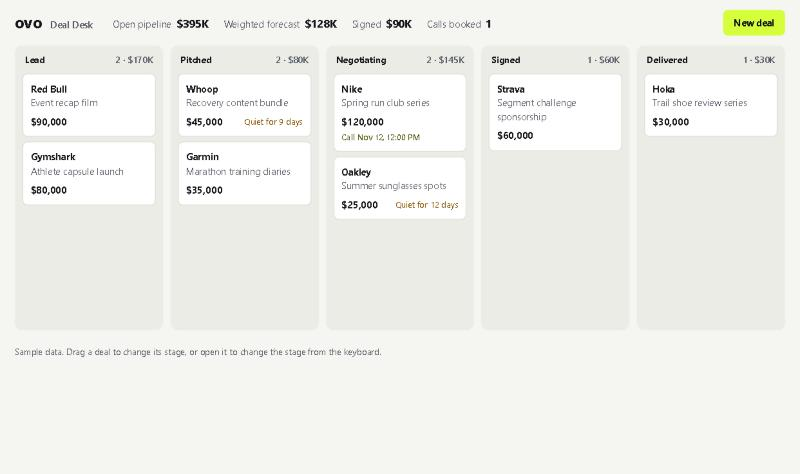
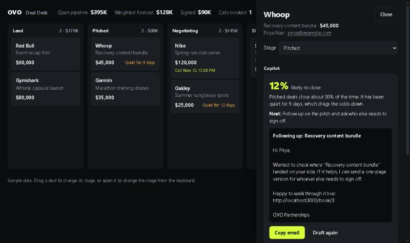

# OVO Deal Desk

A small working version of the three things in the OVO engineering intern post: the CRM, the AI that helps close brand deals, and the booking system. One Node process, one SQLite file, one dependency.





## Run it

Needs Node 22.13 or newer (it uses the built-in `node:sqlite`).

```bash
npm install
```

```bash
npm start
```

Open http://localhost:3000. The database is created and seeded with sample deals on first start.

To have Claude write the copilot drafts, set `ANTHROPIC_API_KEY` before `npm start`. Without it the copilot uses a built-in rules engine, so every feature still works.

## What it does

- **Pipeline board.** Drag a deal between five stages, or change the stage from the keyboard in the deal drawer. The header shows open pipeline, a stage-weighted forecast, and booked calls. Open deals with no activity for 7 days are flagged.
- **Copilot.** Open a deal and choose "Draft next move". It reads the deal's activity log and returns a close score, the single next action, and a ready-to-send email containing that deal's booking link.
- **Booking.** Every deal has a public page at `/book/:id`. The brand contact picks a slot, and the call appears on the deal's timeline and on the board.

## Decisions worth a look

| Decision | Why | Where |
|---|---|---|
| Double-booking is blocked by `UNIQUE(slot)` in the database | Two simultaneous requests cannot both win, which an app-level "is it free?" check cannot promise | `openDb` in [server.js](server.js) |
| The public booking API returns brand and title only | A brand contact with a booking link must never see deal value or internal notes | `/api/book/:id` routes, asserted in [test.js](test.js) |
| Copilot output is JSON constrained by a schema | The UI never has to parse free text | `COPILOT_SCHEMA` |
| The prompt forbids inventing prices or commitments | A drafted email that makes up a number is worse than no draft | `COPILOT_SYSTEM` |
| A rules engine stands in when Claude is unavailable | The demo and the test never depend on the network or a key | `heuristicCopilot` |
| No framework, no build step | The whole server is one file a reviewer can read in a sitting | [server.js](server.js) |
| Light and dark themes from role-based colour tokens | The accent colour is reserved for primary actions | [public/index.html](public/index.html) |

## API

| Method | Path | Purpose |
|---|---|---|
| GET | `/api/deals` | Stages and all deals, each with its next booked call |
| POST | `/api/deals` | Create a deal (starts in Lead) |
| GET | `/api/deals/:id` | One deal with its activity and bookings |
| PATCH | `/api/deals/:id` | Change stage |
| POST | `/api/deals/:id/notes` | Log a note |
| POST | `/api/deals/:id/copilot` | Score the deal and draft the next email |
| GET | `/api/book/:id` | Public: brand, title and slot availability |
| POST | `/api/book/:id` | Public: book a slot |

## Test

```bash
npm test
```

One file, no test framework. It starts the server on an in-memory database and checks input validation, stage changes, the double-booking guard, and that the public booking API does not leak deal value.

## Known limits

- **No login.** The server binds to 127.0.0.1 only. It needs authentication before it runs anywhere else.
- **No timezones.** Booking slots are in the server's local time.
- **One shared calendar.** A slot can be booked once across all deals, which fits one person taking calls and not a team.
- **The Claude path has not been run end to end.** It was written against the SDK docs without an API key to hand; the rules-engine path is the one covered by the test.
- **Sample data is invented.** The brands, values and contacts in the seed are placeholders. Delete `deals.db` to reset.
